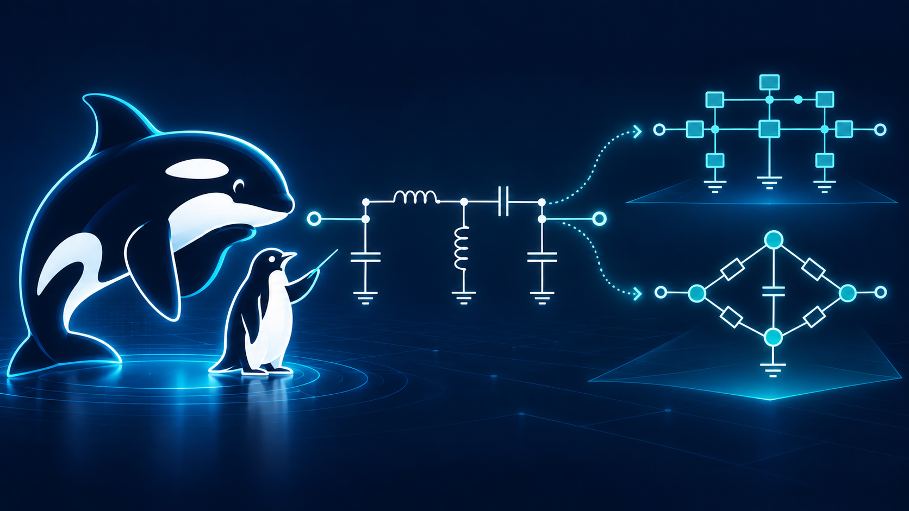
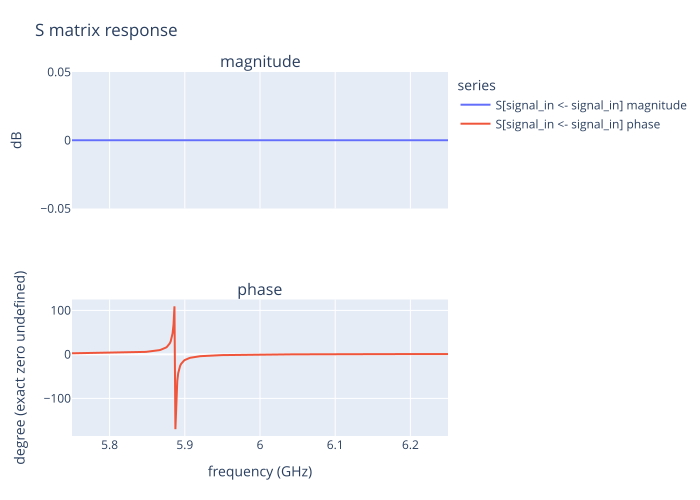

# SCNSim

**Model a superconducting circuit, calculate its response, and explore how its
parameters shape the quantities you care about.**

[](https://github.com/OrPenStrike/scnsim/actions/workflows/ci.yml?query=branch%3Adevelop)
[](LICENSE)
[](pyproject.toml)
[](docs/index.qmd)



SCNSim is a notebook-first Python package for superconducting circuit-network
analysis. Describe components and connections in a `CircuitPlan`, choose the
network to observe through a View, and use `CircuitRun` to calculate typed
Results with physical units. Reuse the same model for responses, characteristic
quantities, derivatives and parameter searches.

<!-- agent-knowledge-start:begin -->
## Agent knowledge start

SCNSim models a physical circuit in one `CircuitPlan`. A View selects its
analysis boundary; a Spec names the requested quantity. Declare the model first,
then choose `CircuitRun` operations. This guide is the installed knowledge entry
`getting-started`.

### Choose a first task

| Task | Detail and resource ID |
|---|---|
| Declare a finite capacitor and inspect its terminals | [Capacitor](docs/reference/agent-catalogue/components/capacitor.md) — `catalogue/components/capacitor` |
| Declare an inductor and its inductive branch | [Inductor](docs/reference/agent-catalogue/components/inductor.md) — `catalogue/components/inductor` |
| Declare a Josephson junction using LJ0 and independent Cj | [Josephson junction](docs/reference/agent-catalogue/components/josephson_junction.md) — `catalogue/components/josephson_junction` |
| Define, bind and substitute physical inputs | [Parameter system](docs/contracts/parameter-system.qmd) — `contracts/parameter-system` |
| Register bodies and assemble their connections | [Circuit Plan assembly](docs/contracts/circuit-plan-assembly.qmd#structured-authoring-grammar) — `contracts/circuit-plan-assembly` |
| Select ordered retained coordinates | [Views and retain](docs/concepts/compilation-coordinates-and-network-views.qmd#network-view-lineage) — `compilation-coordinates-and-network-views` |
| Request the same View's static matrix or entry | [Static capacitance](docs/guides/static-capacitance.qmd) — `static-capacitance` |
| Supply numeric per-length matrices and conductor order | [RLGC](docs/reference/agent-catalogue/api/rlgc.md) — `catalogue/api/rlgc` |
| Choose units and interpret frequency and Result conversion | [Units](docs/concepts/simulation-conventions.qmd#phasors-and-units) — `simulation-conventions` |

The [public catalogue](docs/reference/agent-catalogue/index.md)
(`catalogue/index`) lists exported names and built-in factories. Its construction
observations apply only to the recorded inputs. The
[Component Authoring Contract](docs/component-authoring.qmd)
(`component-authoring`) explains Library ownership and physical models.
[Known public documents outside this bundle](docs/reference/agent-catalogue/known-public-documents.md)
(`catalogue/known-public-documents`) come from the producer's declared source
inventory; an unresolved link alone does not establish that a document exists.

### Inputs, units and common mistakes

Use `from scnsim import units as u` for physical Quantities, for example
`110 * u.fF`; a bare number is not a capacitance. Keep fixed values literal.
Use `ParameterDefinitions` and `ParameterSpec` only for inputs deliberately
consumed by physical component fields; a `ParameterSet` supplies values to
those refs and does not create bindings. Ordinary frequency is in Hz;
angular frequency is in rad/s. Convert a Result's Quantity projection, for example
`root_result.frequency.to("GHz")` or `matrix_result.matrix.to("farad")`,
instead of relabeling its numeric values.

Explicit pins, buses and ground define connectivity. A drawing never creates
an electrical connection. A transmission line requires actual numeric RLGC
matrices, declared conductor order/reference and physical length; its drawing
length is not that length. The Q2D loader accepts its documented distributed
RLGC profile, not an arbitrary lumped capacitance export.

`retain()` selects coordinates on a View. For static C its eliminated finite
complement obeys zero charge; dynamic requests retain their own equations.
`StaticCapacitanceSpec()` has no `zero_charge` input. A root Hint is a local
seed, not a target value or an instruction to discover every root.

### Execution prerequisites and Result ownership

Use an exact-version installation matching your Python/platform. JAX CPU is
the numerical runtime. Notebook
presentation has its own optional dependencies. See the
[setup guide](examples/engineer/setup.qmd) (`engineer-setup`) before executing.
Reading this bundle imports no producer and performs no simulation.

`CircuitRun(plan=plan, storage="memory")` returns detached in-memory Results;
`CircuitRun(plan=plan, workspace=path)` saves supported operations for exact
readback. These are distinct persistence choices. Read
[requests, execution and Result ownership](docs/concepts/requests-execution-and-result-ownership.qmd)
(`requests-execution-and-result-ownership`) before resolving saved evidence or
continuing an optimization. Returned public values remain readable after
`run.close()`; memory Results do not acquire saved request/attempt identities.

SCNSim owns circuit declaration and network calculations. Use the package
that produced electromagnetic/material inputs for their extraction evidence;
SCNSim cannot infer it from a matrix. Quantum Hamiltonian or pulse-dynamics
work belongs to the corresponding circuit-quantization/dynamics tool, not to
an invented SCNSim network result. Cite package version, bundle ID, resource
ID and provenance when using installed knowledge, and report missing content
through the installed package's Issues link rather than fabricating an API.
<!-- agent-knowledge-start:end -->

## What do you want to calculate?

| Calculation | Start here |
|---|---|
| **Circuit response** — S, Y and Z matrices or a named reflection/transmission trace | `run.solve(view, DirectSolveSpec(...))` |
| **Characteristic quantities** — selected operator, root, pole, transfer zero or coupling | `run.evaluate(view, spec, parameters=point)` |
| **Static capacitance** — compiled finite capacitance matrix, View-selected reduction or coordinate entry | `run.evaluate(view, StaticCapacitanceSpec(), parameters=point)` |
| **Sensitivity** — how a quantity changes with circuit parameters | `run.sensitivity(SensitivitySpec(...))` for Jacobian, JVP or VJP |
| **Parameter exploration** — compare a declared sweep or search scalar objectives | Supply a `ParameterSpace` to solve/evaluate, or use `run.optimize(view, OptimizationSpec(...))` |

Read the [Concept overview](docs/concepts/index.qmd) to connect a physical model,
View and quantity before choosing an API. The
[roots and branch-selection guide](docs/guides/roots-and-branch-selection.qmd)
explains why a sampled notch, a complex zero and a local Hint are different
questions. The [Sensitivity guide](docs/guides/sensitivity.qmd) explains units
and local derivatives. Optimization offers CMA-ES, L-BFGS-B, value-first
projected L-BFGS and ordered Hybrid stages; choose the method for your objective
and available derivatives.
The [static capacitance guide](docs/guides/static-capacitance.qmd) covers the
finite matrix, View-selected zero-charge reduction and supported sensitivities.

## Work in memory or save a Workspace

Both modes use the same JAX physical program. For interactive calculations,
`CircuitRun(plan=plan, storage="memory")` keeps Results in RAM without creating
a Workspace. Use `CircuitRun(plan=plan, workspace=path)` when you want to save
calculations, read them again, or continue supported optimization work later.
JAX CPU and Float64/Complex128 are the defaults.

Each operation releases its temporary numerical resources automatically.
Returned Results remain usable after `run.close()`, so plotting, comparing and
reporting do not require keeping a Run open. See
[requests, execution and Result ownership](docs/concepts/requests-execution-and-result-ownership.qmd)
for the storage-specific read, recovery and continuation capabilities.

For repeated calculations, `run.warmup(...)` prepares known executable work
without solving the model. Advanced JAX users can acquire a detached callable
with `run.prepare(...)`. [Benchmark](docs/guides/benchmark.qmd) helps explain
where a calculation spends time. These tools support the calculations above;
they do not change which physical quantity you requested.

## A first Direct S11 result

This Chapter 1 example builds a grounded parallel LC resonator, couples it to
one terminated 50 Ω measurement Port, and requests a named reflection trace.
The physical model and 110 fF / 120 fF values follow the Engineer course.

```python
import numpy as np

from scnsim import (
    CircuitPlan,
    CircuitRun,
    DirectSolveSpec,
    ParameterDefinitions,
    ParameterSet,
    ParameterSpec,
    SParameterTrace,
    components,
    units as u,
)

inputs = ParameterDefinitions(id="readme_lc")
capacitance = inputs.parameter(
    id="capacitance",
    baseline=110.0 * u.fF,
    spec=ParameterSpec(unit=u.fF),
)

plan = CircuitPlan(id="readme_coupled_lc")
resonator = plan.subsystem(id="resonator")
capacitor = resonator.add(
    components.capacitor(id="capacitor", capacitance=capacitance)
)
inductor = resonator.add(
    components.inductor(id="inductor", inductance=5.8 * u.nH)
)
resonator_bus = resonator.bus(id="signal")
resonator.parallel(
    id="parallel_lc",
    start=resonator_bus,
    branches=((capacitor,), (inductor,)),
    end=resonator.ground,
)
resonator_pin = resonator.expose_pin(id="terminal", at=resonator_bus)

signal_bus = plan.bus(id="signal_boundary")
coupling = plan.add(
    components.capacitor(id="coupling_capacitor", capacitance=6.0 * u.fF)
)
plan.series(
    id="coupling", start=signal_bus, elements=(coupling,), end=resonator_pin
)
plan.add_port(
    id="signal_in",
    at=signal_bus,
    role="terminated",
    reference_impedance=50.0 * u.ohm,
)

run = CircuitRun(plan=plan, storage="memory")
reflection = SParameterTrace(
    id="reflection",
    input_port="signal_in",
    input_mode=(),
    output_port="signal_in",
    output_mode=(),
)
direct_spec = DirectSolveSpec(
    frequencies=np.linspace(5.75, 6.25, 401) * u.GHz,
    traces=(reflection,),
)
baseline = run.solve(run.original, direct_spec, parameters=ParameterSet())
selected = run.solve(
    run.original,
    direct_spec,
    parameters=ParameterSet({capacitance: 120.0 * u.fF}),
)
baseline_s11 = baseline.traces["reflection"]
selected_s11 = selected.traces["reflection"]
baseline_s11.show(component="magnitude", magnitude="db")
selected_s11.show(component="magnitude", magnitude="db")
run.close()
```

The code uses the JAX runtime. The figures below are historical Chapter 1
Julia outputs for this authored case and channel. New course figures are
published separately after their JAX execution.


*Stored Chapter 1 baseline Result: 110 fF. The magnitude axis uses a fixed ±0.05 dB display range; the wrapped phase discontinuity is presentation, not solver failure. [Exact complex samples](examples/engineer/figures/01-s11-data.csv).*



*Stored Chapter 1 selected Result: 120 fF, with the same 5.8 nH inductor, 6 fF coupler, 50 Ω Port, and 401-point grid. No dip or resonance is inferred from this plot. [Exact complex samples](examples/engineer/figures/01-s11-data.csv).*

Continue with the [Engineer course](docs/index.qmd).

## Install

Use Python 3.12 and an exact published SCNSim wheel matching your platform.
The current development version is `1.0.0.dev42`; 1.0 beta publication is pending.
JAX CPU is included in the base dependencies. No backend keyword, Julia
installation or Julia extra is required.

For a consumer project, configure its exact SCNSim wheel source and retain that
choice in `uv.lock`. Then install the locked environment:

```bash
uv sync
```

On Windows, use CPython 3.12 AMD64 and the matching Windows wheel. The same
command works in PowerShell. Linux and macOS installations likewise require
a wheel matching their Python ABI and architecture.

Installing a matching prebuilt SCNSim wheel
does not require a C++ compiler. Installing SCNSim from source requires a
C++17 toolchain. Depending on the wheel's MSVC runtime requirements, Windows
may also need the matching Microsoft Visual C++ Redistributable, separate from
the compiler tools; see
[Microsoft's supported Redistributable guidance](https://learn.microsoft.com/en-us/cpp/windows/latest-supported-vc-redist?view=msvc-170).
For CPU JAX, see the [JAX CPU installation notes](https://docs.jax.dev/en/latest/installation.html#cpu).
For a notebook environment and source installation, see the
[setup guide](examples/engineer/setup.qmd).

## Installation history

The previously delivered dev39 wheels and their Windows CPU-JAX observations
remain historical dev39 evidence; they are not installations of dev42.

## Learn the model, then choose the calculation

Start with the [Concept overview](docs/concepts/index.qmd) for the mental model,
or follow the [Engineer course](docs/index.qmd) to build and calculate an
example. Use the focused guides for
[roots and branch selection](docs/guides/roots-and-branch-selection.qmd),
[Sensitivity](docs/guides/sensitivity.qmd) and
[Benchmark](docs/guides/benchmark.qmd) when those questions arise.

## License

Apache-2.0; see [LICENSE](LICENSE) and [NOTICE](NOTICE).
